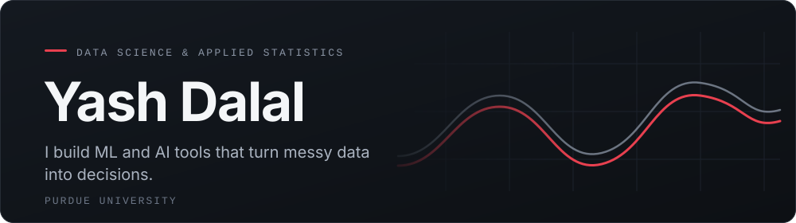
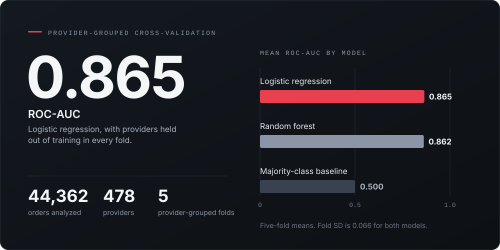

  

I'm a Data Science and Applied Statistics student at Purdue. I like projects where messy, real-world data has to become something a person can act on, from clinical order logs to racing telemetry.

## Selected work

### Ten Tenths Telemetry
*Time-series analysis and an offline AI driving coach*

Racing telemetry analysis for AiM XRK recordings. It estimates lap deltas, analyzes G-G traction and channel distributions, supports unit-checked custom channels, and includes an offline AI driving coach built on a local Gemma model. Desktop releases for macOS, plus a Windows beta.

[Live demo](https://dalal35.github.io/Ten-Tenths-Telemetry/) · [Source](https://github.com/dalal35/Ten-Tenths-Telemetry) · [Releases](https://github.com/dalal35/Ten-Tenths-Telemetry/releases)

 

---

### CogniShift
*Predictive modeling on clinical order data. Purdue ISB Challenge winner.*

Can the first five orders predict how often the next ten will be changed? A provider-grouped study of 44,362 MIMIC-IV orders, scored with logistic regression and random forest against a majority-class baseline. The write-up is explicit about what the model does not show: it measures order-modification activity, not clinician fatigue or medical error.

Best Integration of Science and Business, 2026 Purdue ISB Challenge. Built with Sri Dhruti Sirigibathina.

[Source](https://github.com/dalal35/Cogni-Shift) · [Methodology](https://github.com/dalal35/Cogni-Shift/blob/main/docs/methodology.md)

 

---

## Experience

<table width="100%">
  <tr>
    <td width="34%"><b>American Modern Insurance Group</b></td>
    <td>Portfolio Management (automation and reporting). Earlier, Product Market Analyst intern.</td>
  </tr>
  <tr>
    <td><b>Great American Insurance Group</b></td>
    <td>ServiceNow Developer intern.</td>
  </tr>
  <tr>
    <td><b>Knudsen Institute, Purdue Data Mine</b></td>
    <td>Supply chain intelligence research: web scraping, LLM extraction, supplier risk analysis.</td>
  </tr>
</table>

## Toolkit

<table width="100%">
  <tr>
    <td width="34%"><b>Analysis</b></td>
    <td>Python · SQL · R · pandas · NumPy · SciPy · Matplotlib · Power BI</td>
  </tr>
  <tr>
    <td><b>Machine learning</b></td>
    <td>scikit-learn · PyTorch</td>
  </tr>
  <tr>
    <td><b>Software</b></td>
    <td>TypeScript · React · Rust · Java</td>
  </tr>
</table>

<a href="https://www.linkedin.com/in/yash-dalal35/">LinkedIn</a>

